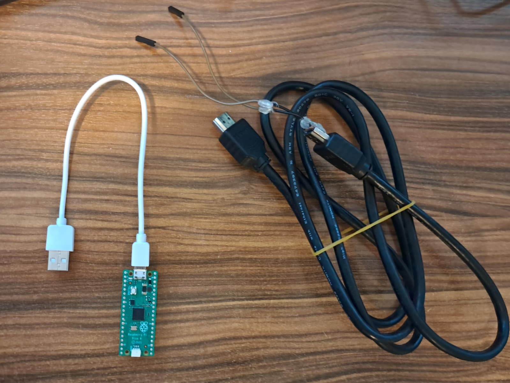

# Couch CEC Controller

[](https://github.com/AtahanAlp/cec-controller/actions/workflows/main.yml)

Make a TV behave like a PC monitor: wake it, select the PC input, and put it in
standby automatically. A Raspberry Pi Pico handles HDMI-CEC and a tiny Linux
client runs only at boot, shutdown, suspend, and resume (no app consuming
system resources all the time!).

> **Current support:** The host integration currently supports Linux with
> systemd and udev. Windows and macOS clients are not yet available, but are
> planned where practical. TV behavior varies, so only the setups in the
> compatibility table below should be considered verified.



## What you need

- Raspberry Pi Pico (RP2040);
- spare HDMI cable to cut/modify for CEC (or a female HDMI breakout board and
  male HDMI cable);
- USB data cable;
- normal HDMI connection from the PC to the TV;
- Podman or Docker for the reproducible build.

The tested setup is an older Samsung Anynet+ TV, but it uses standard HDMI-CEC
commands and should work with many CEC-enabled TVs.

## 1. Wire the Pico

| HDMI Type A pin | Signal | Raspberry Pi Pico |
| --- | --- | --- |
| 13 | CEC | GP11, physical pin 15 |
| 17 | DDC/CEC ground | GND, physical pin 18 |

Plug and receptacle views are mirrored. Read the short
[wiring guide](docs/HARDWARE.md) and verify both wires with a continuity meter
before connecting the TV. Do not connect HDMI +5 V or DDC to the Pico.

## 2. Build and flash

```sh
git clone --recurse-submodules https://github.com/AtahanAlp/cec-controller.git
cd cec-controller
./tools/build-firmware
./tools/build-host
```

Hold the Pico's `BOOTSEL` button while plugging in USB, then copy:

```text
build/firmware/pico-cec.uf2
```

to the `RPI-RP2` drive.

## 3. Test before installing

Turn on HDMI-CEC in the TV settings. With exactly one controller attached:

```sh
device=/dev/serial/by-id/usb-Couch_CEC_Couch_CEC_Controller_*-if00

build/host/cecctl --config /nonexistent --device $device protocol
build/host/cecctl --config /nonexistent --device $device detect
build/host/cecctl --config /nonexistent --device $device status
build/host/cecctl --config /nonexistent --device $device standby
build/host/cecctl --config /nonexistent --device $device on
```

If `detect` cannot identify the video input, add its CEC physical address to
the command, for example `--physical-address 3.0.0.0` for TV HDMI 3.

The version-2 client confirms TV power feedback. `input_unconfirmed` (exit 6)
means power was confirmed but the TV did not provide input-selection evidence.
Check the visible input separately. Update firmware and client together; older
protocol versions are rejected before sending a power command.

## 4. Enable automatic control on Linux

After both manual power commands work:

```sh
sudo ./tools/install-host
cecctl detect
cecctl status
sudo systemctl start cec-controller-boot.service
```

That enables:

- PC boot/resume → wake TV and select the PC input;
- PC suspend/shutdown → put TV in standby.

The included automatic integration supports Linux with systemd and udev,
including Bazzite, Fedora, Ubuntu, Debian, and Arch-based systems. Other
operating systems can implement the small documented
[USB protocol](docs/PROTOCOL.md).

## Configuration

Host settings live in `/etc/cec-controller.conf`. Most setups need no changes.
Useful fallbacks are:

```ini
# Select one GPU output when several HDMI displays are connected.
connector=card1-HDMI-A-1

# Or set the PC video input directly.
physical_address=3.0.0.0
```

The generic firmware build defaults to GP11, matching the wiring above. The
enclosed couch-PC controller is wired to GP1 (physical pin 2) with ground on
physical pin 3, so build its firmware with:

```sh
CEC_GPIO=1 ./tools/build-firmware
```

Set `CEC_GPIO` to match the wire for other custom setups. The firmware reports
its GPIO in `tv protocol` and `show cec`; confirm the value before connecting
the CEC cable.

## Help and project status

- [Wiring](docs/HARDWARE.md)
- [Linux integration](docs/HOST.md)
- [Troubleshooting](docs/TROUBLESHOOTING.md)
- [Build details](docs/BUILD.md)

Verified on the test TV: logical-address allocation, power query, standby,
wake, and automatic switch to HDMI 3 using only CEC and ground. The next step
is repeated lifecycle testing on the Bazzite couch PC. Compatibility reports
and native clients for more operating systems are welcome.

## Tested compatibility

| TV | CEC name | Connection | Host test | Standby | Wake | Select input |
| --- | --- | --- | --- | --- | --- | --- |
| Older Samsung Smart TV (exact model unknown, replacement mainboard) | Anynet+ | CEC on HDMI 2, video on HDMI 3 | Bazzite, three manual off/on cycles | Yes | Yes | Yes |

Real PC boot/shutdown and suspend/resume cycles still require separate
validation. Please include the details listed in
[CONTRIBUTING.md](CONTRIBUTING.md#compatibility-reports) when reporting another
TV or operating system.

This project is derived from [gkoh/pico-cec](https://github.com/gkoh/pico-cec)
and retains its original notices. It is available under the
[MIT License](LICENSE). See [CONTRIBUTING.md](CONTRIBUTING.md) to help.
